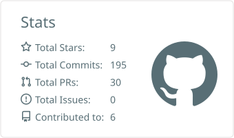
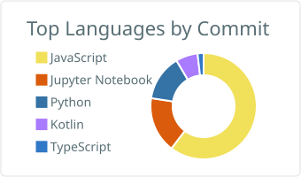

# Hi, I'm Andres 👋

### Backend & Data Developer · Python & SQL · Machine Learning & NLP

📍 Cali, Colombia &nbsp;·&nbsp; 🌎 Open to **Remote** & **Hybrid** &nbsp;·&nbsp; 🗣️  Español / English 

I'm a final-semester **Systems Engineering** student and **Backend & Data Developer** focused on **data engineering** and **database design** with **Python** and **SQL**. I'm currently building a **healthcare data warehouse**, designing **ETL processes** that turn raw data into reliable, analytics-ready models. I've also worked with **Machine Learning**, **neural networks** and **Natural Language Processing (NLP)**, and I build **REST APIs** and **automate software testing**. In **Scrum** teams, I've led the team and owned the testing process.

🎓 **Systems Engineering** · **Universidad del Valle** · Graduating: 2027

**🎯 Interested in:** Data Engineering · ETL Pipelines · Backend Development · Machine Learning & AI · QA Automation

---

## 🔎 Focus Areas

- **Data Engineering:** Data Warehousing, ETL Pipelines, Dimensional Modeling (Star Schema), Database Design, Data Quality, Power BI
- **Backend Development:** REST APIs, Python, SQL, relational and NoSQL databases, Docker
- **Artificial Intelligence:** Machine Learning, Neural Networks, Natural Language Processing (NLP)
- **Quality Assurance:** Test Automation, automated testing in the development workflow
- **Ways of working:** Agile methodologies (Scrum and Kanban), Technical Leadership

---

## 💼 Experience & Featured Projects

### 🏥 Healthcare Data Warehouse · *Data Engineering*
**Undergraduate thesis project (Systems Engineering)** · January 2026 – Present

- **What I built:** A data warehouse prototype for a hospital trauma unit that consolidates data from two independent clinical sources into a star-schema analytical model, with an automated ETL pipeline and an interactive dashboard.
- **Tech:** Python · pandas · SQLAlchemy · PostgreSQL · SQL · Power BI · pytest · Git
- **Problem solved:** Clinical records were split across separate systems with different formats and labels, so they could not be analyzed together and their quality was hard to verify.
- **Impact:** Unified tens of thousands of historical records into a single traceable model, with source-to-warehouse reconciliation, an automated data quality report on every load, and 700+ automated tests.

<!--
  PLANTILLA: copia este bloque para cada proyecto adicional (recomendado: entre 2 y 4 en total).
  Ideas según lo que me contaste: un pipeline ETL, una suite de automatización de pruebas,
  un proyecto donde lideraste el equipo.

### ⚙️ Project Name · *Your Role*
**Company / Personal project** · Dates · [Repository](https://github.com/AndresIsCoding/REPO)

- **What I built:** ...
- **Tech:** ...
- **Problem solved:** ...
- **Impact:** ...
-->

---
## 🛠️ Tech Stack

### 💻 Programming & Backend

**Python · SQL · REST APIs**

  
<!-- Descomenta el framework o herramienta que uses:

-->

*Familiar with:* JavaScript · HTML5 · CSS

  

### 🗄️ Data Engineering & Databases

**PostgreSQL · Supabase · Google Cloud Firestore (NoSQL) · Data Warehousing · ETL · Star Schema (Dimensional Modeling) · Database Design · Data Quality · pandas · SQLAlchemy · Business Intelligence (BI) · Power BI**

     

     

### 🤖 AI & Machine Learning

**Machine Learning · Neural Networks · Natural Language Processing (NLP)**

  
<!-- Descomenta las librerías que uses:

-->

### 🧪 Testing & DevOps

**Test Automation · Pytest · Selenium · Cross-Browser Testing · Docker · Git · GitHub**

    

 
<!-- Descomenta las que uses:

-->

### 🤝 Methodologies & Leadership

**Agile · Scrum · Kanban · Team Leadership**

   
<!--
  Certificaciones (opcional). Usa siempre el nombre oficial exacto, porque es una palabra clave muy buscada.
## 📜 Certifications
- Certification Name — Issuer (Year)
-->

---

## 📊 GitHub Stats

<!-- Estas tarjetas las genera .github/workflows/profile-summary-cards.yml dentro de este repositorio -->

  
  

---

## 📫 Contact

**LinkedIn:** TODO · **Portfolio:** TODO · **Email:** TODO

---

🇪🇸 <b>Versión en español</b>

 

### Desarrollador Backend y de Datos · Python y SQL · Machine Learning y PLN

📍 Cali, Colombia · 🌎 Disponible para trabajo **remoto** e **híbrido**

Soy estudiante de último semestre de **Ingeniería de Sistemas** en la **Universidad del Valle** y **desarrollador backend y de datos**, enfocado en **ingeniería de datos** y **diseño de bases de datos** con **Python** y **SQL**. Actualmente construyo una **bodega de datos (data warehouse) para el sector salud**, donde diseño **procesos ETL** que convierten datos crudos en modelos analíticos confiables. También he trabajado con **Machine Learning**, **redes neuronales** y **Procesamiento de Lenguaje Natural (PLN)**. Además, desarrollo **APIs REST** y **automatizo pruebas de software**. En equipos **Scrum** he liderado el equipo y he sido responsable del proceso de testing.

**🎯 Áreas de interés:** Ingeniería de Datos · Pipelines ETL · Desarrollo Backend (Python) · Machine Learning e IA · Automatización de Pruebas (QA)

